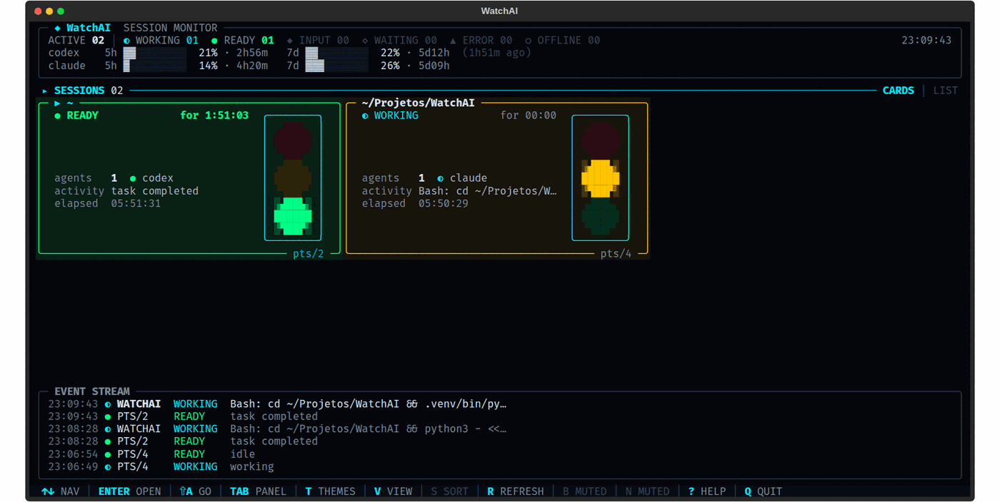

# WatchAI for VS Code

See your local AI-agent sessions in the VS Code sidebar without duplicating the
WatchAI detection logic. The extension starts the local `watchai --json` core
and shows:

- a tree with one item per terminal and its agents;
- the same READY, WORKING, WAITING, INPUT and STOP signals as the terminal UI;
- a compact summary in the status bar;
- native VS Code notifications for states that need attention;
- click-to-reveal when the session belongs to an integrated terminal in this window.



## Requirement

The Python core is intentionally not bundled. Install it from the public source:

```bash
pipx install git+https://github.com/LeandroDukievicz/WatchAI.git
```

If `watchai` is not in the VS Code extension host PATH, set
`watchai.command` to its absolute path.

The monitor reads local processes and agent journals. It does not send session
data to a server. Known detection limits are documented in the
[main repository](https://github.com/LeandroDukievicz/WatchAI#os-limites-ditos-na-cara).

## Development installation

```bash
cd vscode-extension
npm ci
npm run package
code --install-extension watchai.vsix
```
